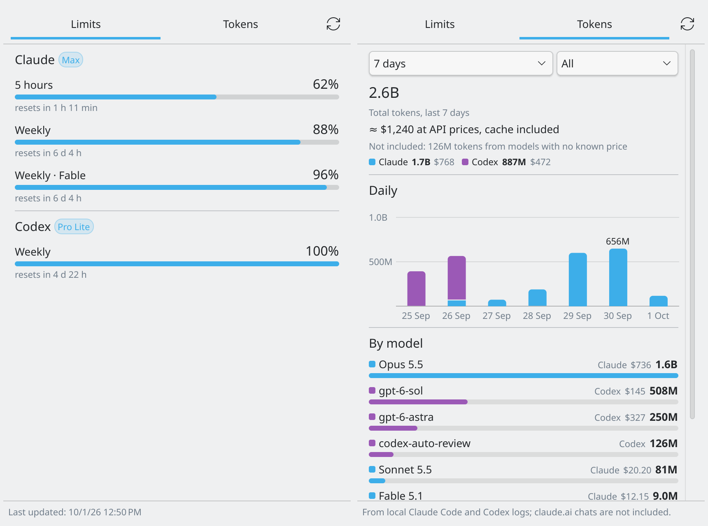
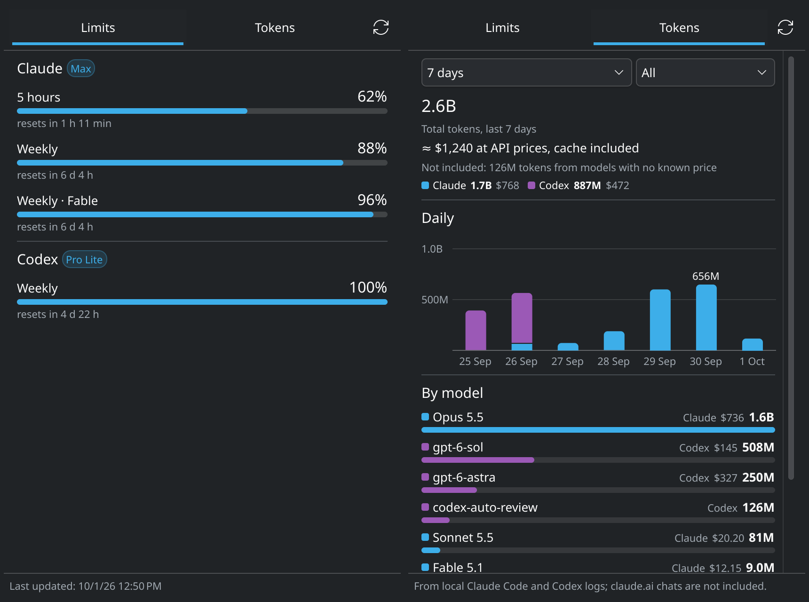
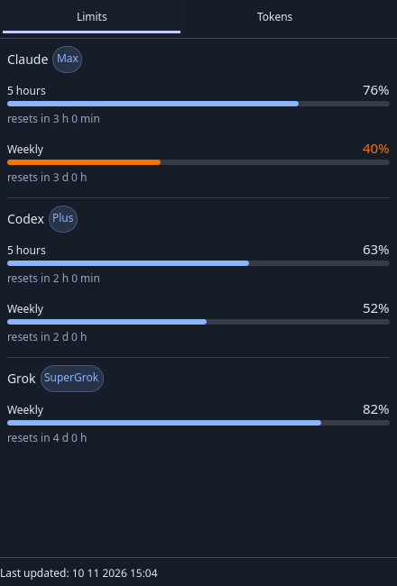
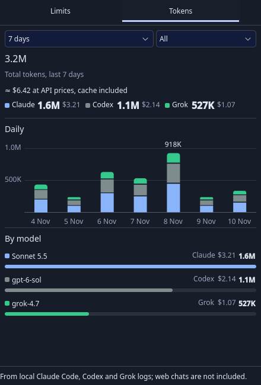

# Agents Usage

A KDE Plasma 6 widget that shows how much of your usage limits are left on Claude, OpenAI Codex and Grok subscriptions, plus a second tab with tokens by day and by model counted from the local Claude Code, Codex and Grok logs (so only as far back as those tools keep them, and without claude.ai chats) and what they would have cost at API list prices, cache included, using LiteLLM's public price list fetched once a day. The text follows the system language, English or Turkish. It reads the logins Claude Code (`~/.claude/.credentials.json`) and the Codex CLI (`~/.codex/auth.json`) already keep, so both need to be signed in once. An expired Codex token is refreshed the way the CLI does it and written back to `auth.json`; the Claude token is only read, so after a long break from Claude Code the widget shows the last known numbers until you open `claude` again. It refreshes every 5 minutes and whenever the popup opens.

Grok limits are read directly from its CLI billing service using the existing `grok login` session in `~/.grok/auth.json` (`GROK_HOME` is respected). Weekly and monthly credit windows are shown with their reset time and plan name when provided. The widget only reads Grok credentials; renew an expired session with `grok login`. Missing usage percentages are reported as unavailable, and a failed refresh keeps the last known values marked as stale. The Tokens tab reads Grok’s per-session `usage.json` snapshots, grouping each turn by its end date and model. Cached input and reasoning tokens are not counted twice. Rewritten snapshots replace their previous contribution, and nested artifacts are not scanned. API-equivalent costs use the xAI entries in the same LiteLLM price list; missing prices are reported as unpriced tokens. These are estimates, not subscription charges or a conversion of Grok’s internal cost ticks.








## Install

Needs Plasma 6, `python3`, and `msgfmt` (gettext) for the Turkish translation.

```sh
git clone https://github.com/yusufipk/kde-agents-usage.git
cd kde-agents-usage
./install.sh
```

Then add "Agents Usage" to a panel (right click the panel, Add Widgets), or open the system tray arrow, Configure System Tray, and set it to always shown. To update, run `git pull && ./install.sh` and restart Plasma with `systemctl --user restart plasma-plasmashell`.

## Tests

Run the Grok provider tests without credentials or network access:

```sh
python3 -m unittest discover -s tests -v
```
